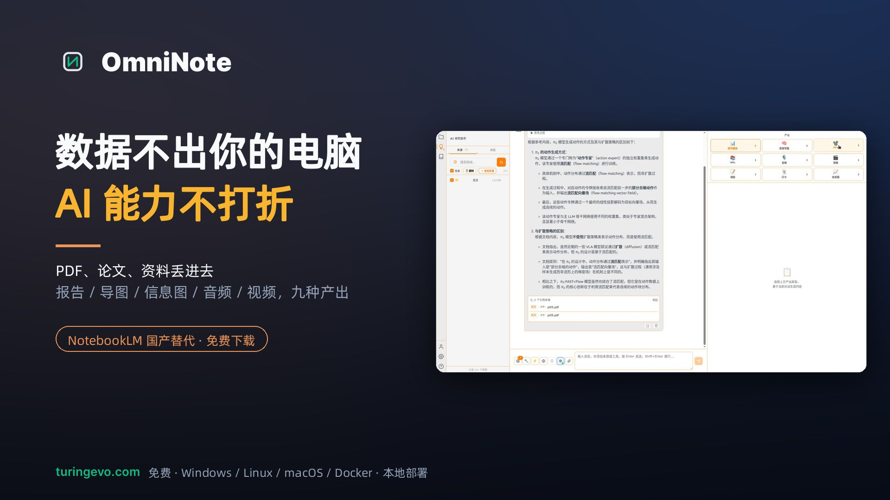
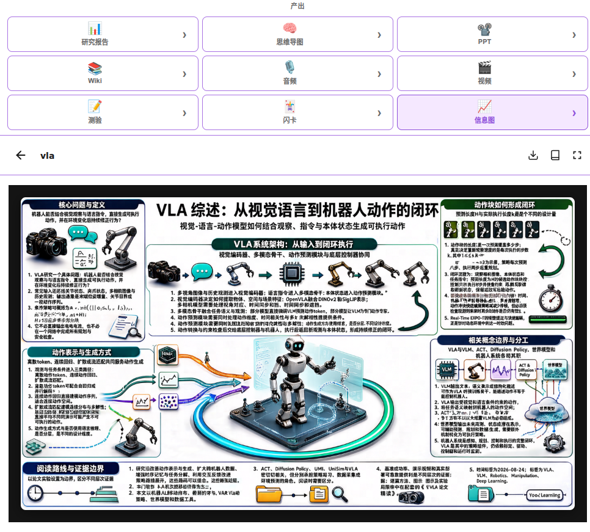
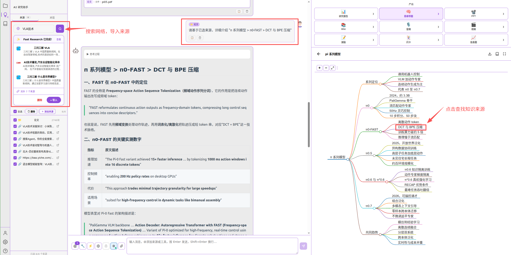

[](README_en.md) [](README.md) [](https://github.com/turingevo/Omni-note/releases) [](https://turingevo.com)

# OmniNote — Your Local AI Knowledge Brain

> **Multimodal Notes × Graph RAG × 9 Output Engines × Agent Platform**
> Local Edition keeps everything on your machine; Cloud Edition works with a single API key.

---

## 🎬 Video Demo

[](https://www.bilibili.com/video/BV1nUxB65EHS?t=5.2)

📺 **[Bilibili: a free NotebookLM alternative — local knowledge base + nine AI outputs](https://www.bilibili.com/video/BV1nUxB65EHS?t=5.2)**





---

## Why OmniNote?

| | OmniNote | Traditional Notes | Cloud AI Notes |
|---|:---:|:---:|:---:|
| Data Privacy | ✅ Local Edition is 100% local, data encrypted | ✅ Local storage | ❌ Uploaded to cloud |
| Multimodal | ✅ Text / Image / Audio / Video | ❌ Text only | ⚠️ Partial |
| Knowledge Graph | ✅ Graph RAG triple fusion | ❌ None | ❌ None |
| Structured Output | ✅ 9 engines (reports, mindmaps, PPT…) | ❌ None | ⚠️ Limited |
| AI Agents | ✅ MCP / SKILL, infinite extensions | ❌ None | ❌ None |
| Hardware | ✅ Runs on CPU, auto-accelerates on GPU | ✅ Low | — |

---

## ✨ Core Capabilities

### 🧠 Graph RAG Knowledge Base

Triple-fusion retrieval: **BM25 keywords + Vector embeddings + Knowledge graph**, combined with entity extraction and community clustering. Your notes don't just *store* information — they *understand* it.

- Auto-parse PDF / Word / PPT / Excel / Markdown / images / audio & video
- Adaptive chunking (parent-child hierarchy), multi-KB isolation & management
- ReAct Agent for intelligent multi-step reasoning, with source citations

### 📝 9 Structured Output Engines

Transform knowledge base content into actionable deliverables with one click:

| Engine | Output | Engine | Output |
|--------|--------|--------|--------|
| 📊 Research Report | Markdown long-form | 🗺️ Mind Map | Markmap visualization |
| 🃏 Flashcards | Study cards | 📋 Quiz | Self-assessment |
| 📰 Infographic | Visual poster | 📖 Wiki | Knowledge pages |
| 📑 PPT | .pptx presentation | 🎙️ Audio Interview | Two-host podcast |
| 🎬 Explainer Video | Lecture slides + voiceover + captions | | |

### 🤖 Agent Platform

Connect weather, search, file processing, and any third-party tool via MCP (Model Context Protocol); the skills (SKILL) marketplace packages prompts and workflows for reuse — all through a single conversational interface.

### 🔀 Model-Agnostic Design

Notes are fully decoupled from models. Every capability speaks an OpenAI-compatible API:

- **Recommended: [official API](https://api.turingevo.com)** — just add an API key; pay as you go, no model downloads, no VRAM usage
- **Optional: local models** — switch any capability to on-device inference and run fully offline

| Capability | API Standard | Local Model (Optional) |
|------------|--------------|------------------------|
| Vision-Language | OpenAI Chat | Qwen3.5-4B |
| Embedding | OpenAI Embedding | Qwen3-Embedding-0.6B |
| Reranker | Rerank | Qwen3-Reranker-0.6B |
| Image Generation / Infographic | OpenAI Images | SenseNova-U1.5-8B (8-step) |
| Speech Recognition | OpenAI Audio | Qwen3-ASR-0.6B |
| Text-to-Speech | TTS | Qwen3-TTS-1.7B |

### 🧩 On-Demand Model Lifecycle

Only chat, embedding, and reranking services stay resident. Image generation, ASR, and TTS start on demand and stop when the job finishes — all nine outputs run even on a modest GPU.

---

## 🛡️ Security & Performance

- **Private by Default** — Local Edition runs every inference on your machine, no internet required. Database end-to-end encryption.
- **Low-Bit Quantization** — GGUF Q4_K_M / Q5_K_M / Q8_0 quantization runs on CPU and offloads to GPU automatically when available.
- **Flexible Deployment** — Single machine / LAN multi-user / Docker containerized.

---

## 📦 Versions & Downloads

| Edition | Package | Notes |
|---------|---------|-------|
| **Cloud Edition (Recommended)** | `omni-note-cloud-linux-x64-v2.1.4.tar.xz` | API key only, models run in the cloud |
| **Local Edition** | `omni-note-local-linux-x64-v2.1.4.tar.xz` | All models run locally, fully offline |
| **Docker / Server** | `omni-note-app_latest.tar.gz` + `instance-init.zip` | Pair with `omniManager-linux-x64.zip` for model management |

> See [Release Notes](https://github.com/turingevo/Omni-note/releases). Older versions are available in Releases.

---

## 🚀 Quick Start

```bash
# Extract (swap "cloud" for "local" on the Local Edition)
tar -xf omni-note-cloud-linux-x64-v2.1.4.tar.xz
cd OmniNote-cloud-linux-x64

# Launch
chmod a+x ./OmniNote && ./OmniNote

# Open http://localhost:7000 in your browser
```

- **Cloud Edition**: sign in, then enter your API key under Settings → Model Services ([get one](https://api.turingevo.com/pricing))
- **Local Edition**: use the bundled `omniManager` to download models and inference tools, then start model services on demand
- **Docker**: import the image and initialize the data directory with `instance-init.zip`

---

## 🏆 Recognitions

- **Arm 2024 AI Innovation Application Contest — Excellence Award**
- **Intel 2025 AI Innovation Application Contest — Winner Award**
- **Lenovo Title Sponsor Special Award**
- **Qualcomm Snapdragon AI Contest — Excellence Award**

---

## 📚 Documentation

Product documentation lives at **[turingevo.com/blog](https://turingevo.com/blog)**, under the "产品文档" (Product Docs) group in the sidebar:

| Document | Content |
|----------|---------|
| [Docker Deployment](https://turingevo.com/blog) | Image, compose, data package; models run on the host |
| [Preparing Data](https://turingevo.com/blog) | instance runtime data for Docker (templates, fonts, skills) |
| [Quick Start: Cloud](https://turingevo.com/blog) | Cloud Edition — sign up, get an API key, configure models |
| [Quick Start: Local](https://turingevo.com/blog) | Local Edition — model download and service orchestration |
| [Knowledge Base Guide](https://turingevo.com/blog) | Start EBD/RNK, build & sync, upload and search |
| [Admin UI Guide](https://turingevo.com/blog) | omniManager: download models, start services, MCP, hardware |

> The blog is a single-page app, so every link opens the docs home; pick the matching title under the "产品文档" group on the left.

---

## 🌐 Connect

| | |
|---|---|
| 🌍 Website | https://turingevo.com |
| 📝 Blog | https://turingevo.com/blog |
| 🔑 Model API | https://api.turingevo.com |
| 💻 GitHub | https://github.com/turingevo |
| 🤗 Hugging Face | https://huggingface.co/turingevo |
| 🤖 ModelScope | https://www.modelscope.cn/profile/TuringEvo |
| 💬 QQ Group | 873673497 |
| 📧 Email | wmx@turingevo.com |
